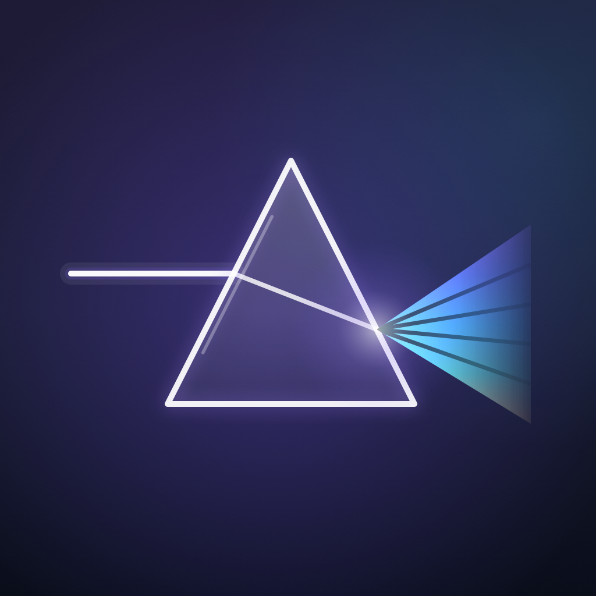

# Prism 应用图标

> 状态：已实现（`App/Assets.xcassets/AppIcon.appiconset/`）
> 生成器：`scripts/generate-icon.swift`（纯 CoreGraphics，无设计工具依赖）
> 最后更新：2026-10-21



## 1. 设计理念

Prism 是棱镜：白光射入，被分解成光谱。图标把这件事画成三个动作——**入射、折射、发散**。
深靛蓝的底子上，一块几何精确的等边棱镜（顶点朝上）用极淡的白色玻璃质感填充、亮白描边；
一道水平白光从左侧射入左面，在玻璃内部向下折一次，从右面射出时展开成紫→青→金的五道光带，
并在右缘溶解进背景。品牌色 `#7B5CFF`（紫）与 `#3EC6FF`（青）既是背景辉光，也是光谱的首尾。
没有文字、没有播放符号：16 px 下播放三角会和棱镜抢注意力，而「棱镜」本身就是最强的识别点。

选 **方案 A（棱镜折射）** 而不是 B/C 的理由：单焦点、纯几何、高对比，缩到 16 px 仍能读出
「一个三角形 + 一束光」；B 的播放三角与 C 的多层色带在 16/32 px 会糊成一团。

## 2. macOS 图标规范查证（2026-10）

**问题**：macOS 26 引入 Liquid Glass 之后，图标还是「方形画布 + 系统圆角」，还是要提供分层图标？

**结论（三条，都已在本机 macOS 27.0 上实测验证）**

1. **画布仍然是方形**，由系统裁切成圆角矩形。HIG 的 Specifications 表把 iOS / iPadOS / macOS 放在同一行：
   `Layout shape = Square`、`Icon shape after system masking = Rounded rectangle (square)`、`Layout size = 1024×1024 px`。
   HIG 正文进一步说明："In iOS, iPadOS, and macOS, icons are square, and the system applies masking to produce
   rounded corners…"，以及 "Provide square layers so the system can apply rounded corners. Providing layers with
   pre-defined masking negatively impacts specular highlight effects and makes edges look jagged."
   → **不要自己画圆角，也不要自己留出 824 的圆角容器。**
2. **推荐分层（Layered），但不是强制**。HIG 把 macOS 图标的 Style 标为 `Layered`，推荐用 Icon Composer
   产出 `.icon`（背景层 + 前景层，带 Default / dark / clear / tinted 变体），Xcode 26+ 会用它替代同名
   `AppIcon` 资产。**扁平 PNG 资产目录仍然是合法的回落方案**，只是拿不到 Liquid Glass 的高光/折射/深度，
   只会被系统套上正确形状。
3. **边缘 alpha 必须 = 255，否则会被「Squircle Jail」**。社区实测（Apple Developer Forums #797971）：
   macOS 26 判定「这个图标是否为新规范设计」的唯一条件是**边缘像素 alpha**——
   `α ≥ 253` → 直接用标准圆角裁切，铺满整块；
   `α ≤ 252` → 强制套一个系统圆角外框并把内容缩小内缩（即「jail」）。
   这与「预留 100 px 透明边距」的旧版 macOS 11–15 网格正好相反：旧的 824-on-1024 图标在 Tahoe 上会被
   缩小并装进一个框里，显得比邻居小一圈。

**因此本实现**：1024 画布**满幅不透明**（四角 alpha 实测 255，生成脚本每次都会自检并打印），
内容（棱镜 + 光束 + 光谱）收在约 11% 的边距内，圆角交给系统。

**来源**

- Apple HIG · App icons：<https://developer.apple.com/design/human-interface-guidelines/app-icons>
  （Specifications 表；"Layer design" / "Produce appropriately shaped, unmasked layers" 段落；2026-06-08 修订）
- Apple Developer Forums · *Squircle app icons on macOS 26*：<https://developer.apple.com/forums/thread/797971>
  （边缘 alpha 253/252 阈值的 12 组对照实验）
- Parakeet · *The Shape of Apps*：<https://parakeet.co/blog/the-shape-of-apps>（三种 squircle jail 的成因）
- Apple · Icon Composer：<https://developer.apple.com/icon-composer>（分层 / Liquid Glass / `.icon`）
- WWDC25 Session 361 *Create icons with Icon Composer*（分层、外观变体、不导出圆角遮罩）

**实测**：把编译产物装进一个临时 `.app` 后，用 `NSWorkspace.icon(forFile:)` 取系统渲染结果——
图标被裁成新圆角形状并**铺满整块**（没有外框、没有内缩），系统还自动加了一圈顶部高光。
说明满幅方形方案在 macOS 27 上是正确的。

## 3. 尺寸与简化策略

`Contents.json` 使用 `idiom: mac` 的 5 组 size × 2 scale，共 10 个文件，实际像素尺寸 7 种：

| 文件 | 像素 | 细节等级 |
|---|---|---|
| `icon_16x16.png` | 16 | **极简**：棱镜填充（α 0.34→0.16，比大图亮得多）+ 1.6 px 描边 + 1.6 px 光束 + **单条**渐变光谱楔（无分带、无辉光） |
| `icon_16x16@2x.png` / `icon_32x32.png` | 32 | **简化**：同上，但描边 2.0 px、光谱 3 条分带（1 px 分隔）、无辉光/高光 |
| `icon_32x32@2x.png` | 64 | 完整 5 条光谱（1.1 px 分隔），描边 2.4 px，仍无辉光 |
| `icon_128x128.png` | 128 | 加入入射光束外辉光；描边 2.8 px |
| `icon_128x128@2x.png` / `icon_256x256.png` | 256 | 全细节：辉光 + 棱镜边缘紫色光晕 + 玻璃高光条；描边 3.4 px |
| `icon_256x256@2x.png` / `icon_512x512.png` | 512 | 全细节 |
| `icon_512x512@2x.png` | 1024 | 全细节（母版） |

所有尺寸都是**按目标像素独立绘制**（不是从 1024 缩放），描边/光束宽度按 `max(设计宽度, 最小设备像素)`
夹紧，保证 16 px 下不会细到消失；小尺寸同时提高棱镜填充亮度，否则深底上的三角形会只剩一圈线。

其他一致性处理：

- 满幅不透明背景（深靛蓝渐变 `#1E1B36 → #171A2E → #0A0E1B` + 紫/青径向辉光），四角 alpha = 255；
- 光谱使用 `CGGradient`（紫 `#8B5CF6` → 蓝 `#5B7CFF` → 青 `#3EC6FF` → 青绿 `#4FE3C1` → 金 `#FFD166`），
  以 `plusLighter` 叠加，让颜色「发光」而不是像颜料；
- 光谱远端用 alpha 渐变蒙版溶解，避免在右侧出现一条硬边；
- 不烘焙投影、不烘焙外框阴影（HIG：系统负责光影），只有一层很淡的紫色边缘光晕用于与深色背景分离。

## 4. 重新生成

```bash
# 在仓库根目录
swift scripts/generate-icon.swift
```

脚本会：

1. 按上表逐尺寸绘制并写入 `App/Assets.xcassets/AppIcon.appiconset/*.png`（72 dpi，sRGB）；
2. 重新生成同目录的 `Contents.json`（PNG 与 JSON 永远同步，不要手改）；
3. 打印每个文件的尺寸与**四角 alpha**，任何一角不是 255 就以退出码 2 失败。

改设计只需要改 `scripts/generate-icon.swift` 顶部的 `Palette` / `Geo` / `style(for:)`：
`Geo` 是 1024 设计坐标系（原点左上、y 向下），`style(for:)` 决定每个像素尺寸保留多少细节。

编译资产（可选，验证用）：

```bash
/Applications/Xcode.app/Contents/Developer/usr/bin/actool App/Assets.xcassets \
  --compile /tmp/prism-icon --platform macosx --minimum-deployment-target 15.0 \
  --app-icon AppIcon --output-partial-info-plist /tmp/prism-icon/partial.plist
```

## 5. 验证记录

- 10 个 PNG 全部存在，`sips -g pixelWidth -g pixelHeight` 与 `Contents.json` 声明逐一吻合（16/32/64/128/256/512/1024）。
- `python3 -m json.tool Contents.json` 通过。
- `actool` 编译**零 warning**，产出 `AppIcon.icns`（116 KB）、`Assets.car`（2.0 MB）和
  `partial.plist`（`CFBundleIconFile` / `CFBundleIconName` 均为 `AppIcon`）。
- 真实 App：`build/Build/Products/Release/Prism.app/Contents/Resources/` 下同时存在 `AppIcon.icns`
  与 `Assets.car`，`Info.plist` 带 `CFBundleIconName`；`NSWorkspace` 取到的图标形状正确、内容清晰。
- 视觉检查：见 `docs/ICON.md` 顶部预览与各尺寸结论（1024 细节清晰、32 可辨认、16 保留三角形 + 一抹光谱）。

## 6. 已知限制与后续

1. **不是 Liquid Glass 分层图标**。当前是扁平 PNG 资产目录，macOS 26/27 只会裁形状、加系统高光，
   没有 Icon Composer 的折射/深度/多外观。要做真·分层图标，需要用 Icon Composer 产出
   `AppIcon.icon`（背景层 + 棱镜层 + 光谱层），Xcode 26+ 会自动用它替代同名资产目录——
   这需要人工在 GUI 里操作，且要新增 `App/AppIcon.icon` 资源（超出本任务的文件范围）。
   本实现的 PNG 可以直接当作 Icon Composer 的分层素材来源。
2. **macOS 15（deployment target）上会显示为直角方形**。满幅不透明是 macOS 26+ 的正确做法，
   但 macOS 15 不做系统遮罩，会露出直角。旧式「824-on-1024 圆角容器」在 Tahoe 上会触发
   squircle jail（更糟），所以这里选择跟随新规范。若确实需要兼顾 15，唯一干净的办法是
   在 15 上回落到旧 `.icns` 资产——需要额外的构建脚本，当前未做。
3. **`AppIcon.icns` 只含 16/32/128/256**（实测 actool 27.1 行为，与部署目标无关）。
   高分辨率由 `Assets.car` 提供，`.icns` 只是旧路径的回落，不影响 Dock/Finder。
4. **没有 dark / tinted 外观变体**。扁平资产目录不参与系统外观变体；深色底本来就在两种外观下都可读。
   等迁移到 Icon Composer 时一并补齐。
